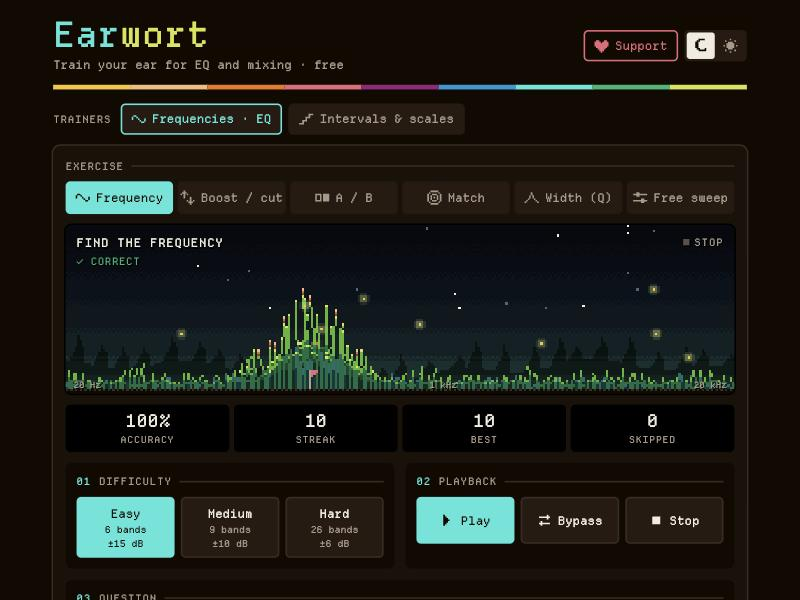
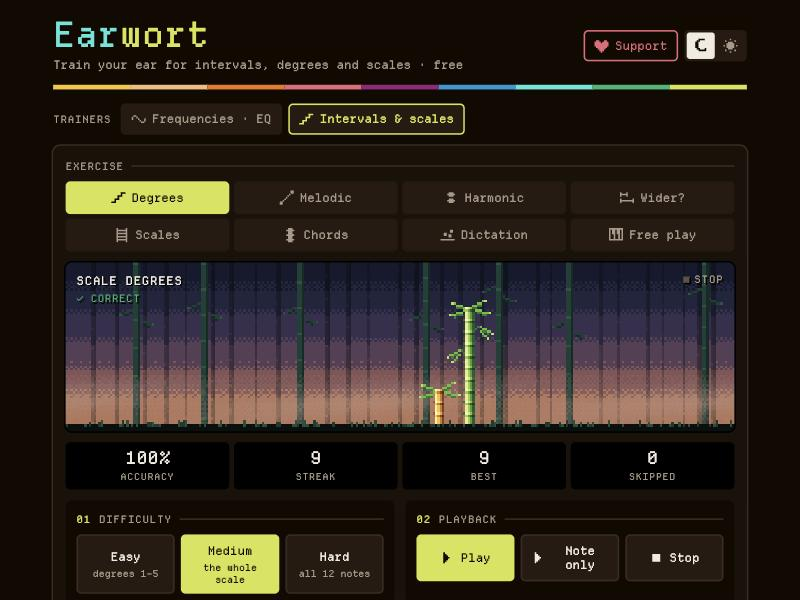

# Earwort

Earwort is free ear training in your browser. Learn to hear EQ, intervals and chords.

It has two trainers: one for mixing engineers, one for musicians. You need no account. The pages have no ads and no
trackers, and they make no network requests. Your browser makes every sound.

**Try it:** [Frequencies · EQ](https://ficusficusov.github.io/earwort/) · [Intervals & scales](https://ficusficusov.github.io/earwort/intervals.html)

| Frequencies · EQ | Intervals & scales |
| --- | --- |
|  |  |

## Frequencies · EQ

[`index.html`](index.html) teaches you to hear EQ: which band changed, and how. If you know SoundGym, Quiztones
or TrainYourEars, these exercises will feel familiar.

- **Frequency.** A band is boosted on pink noise. Pick it. Hold **Bypass** to hear the sound without the EQ.
- **Boost / cut.** Was the band boosted or cut, and where?
- **A / B.** You get two versions. Which one has the EQ?
- **Match.** Turn a knob until your band sounds like the reference.
- **Width (Q).** How wide is the boosted band?
- **Free sweep.** Turn the EQ yourself. Nothing is scored.

Easy uses 6 octave bands at 15 dB. Medium uses 9 at 10 dB. Hard uses 26 third-octave bands at 6 dB. You can train
on pink noise, white noise, a sine tone or your own track.

Seven of the eleven reference bands have a speech sound to remember them by. 250 Hz sounds like "oo" in *boot*, 1 kHz like "ah" in
*father*, 4 kHz like "ee" in *see*. The reference card lists them all.

**The screen is a meadow at night, laid out like an EQ:** low frequencies on the left, high on the right. When you
answer, the grass grows into the EQ curve you heard. A boost makes a hill; a cut makes a dip. The width of the
hill is the width of the band. In Frequency, Boost / cut and Match, a stake marks the frequency you picked. Each
correct answer in a row lights a firefly, and a miss or a skip sends them all away.

## Intervals & scales

[`intervals.html`](intervals.html) teaches you to hear scale degrees, intervals, scales, chords and short tunes. Users
of Functional Ear Trainer or EarMaster will know these exercises.

- **Degrees.** A cadence sets the key, then one note sounds. Name its scale degree. This is the main exercise.
- **Melodic.** Two notes, one after the other. Name the interval.
- **Harmonic.** Two notes at once. Name the interval.
- **Wider?** Which of two intervals is wider? You need no theory for this one.
- **Scales.** Start with major and minor, then work up to fourteen scales and modes, Phrygian dominant included.
- **Chords.** Start with major and minor, then work up to twelve chords, sevenths included.
- **Dictation.** A short tune plays. Tap its scale degrees in order.
- **Free play.** Play a two-octave keyboard over a tonic drone, in any of 12 keys and 14 scales.

Notes can show as letter names, scale degrees (1 ♭3 5) or movable-do solfège. Letter names follow the key: the 4th of
A♭ major is D♭, not C♯. In Degrees, after a correct answer, the note resolves to the tonic, so your ear learns the
pull of each degree. You can turn this off. Items you often get wrong come up more often, and the **Ear map** shows your accuracy on each one until you reload
the page.

**The screen is a bamboo grove in the mist.** Each note grows as a stalk. Each joint of a stalk is one semitone,
so you can count an interval in joints. The golden stalk is the tonic, or the root. A run of correct answers
brings the dawn: the night sky gets lighter with each one.

## Keyboard

| Key | Frequencies | Intervals & scales |
| --- | --- | --- |
| Space | play or stop | play |
| K | | the second play button: “Note only”, “Slower”, “One by one”… |
| 1–9 | answer | answer |
| → or N | next | next |
| A, B | play A or B | first or second (Wider?) |
| Enter, Backspace | | check, erase (Dictation) |

## Run it yourself

Each trainer is one HTML file, with its pixel font inside. Open `index.html` or `intervals.html` in a browser, or
serve the folder from any static server. On a phone, open the file in Safari or Chrome: the buttons don’t work in a
file preview.

A page remembers one thing, in your browser only: the light or dark theme.

## For developers

- Both pages share their look and their common code: icons, theme, knobs, the pixel screen, the support dialog.
  Edit the shared parts in `index.html`, between the `=== shared ===` and `=== this page ===` banners. Then run
  `python3 tools/sync_shared.py` to copy them into `intervals.html`.
- `tools/build_font.py` builds `fonts/earwort-mono.woff2`. It takes Departure Mono, draws the signs the font lacks
  (♯ ♭ ♮ ✓ ✗) on its pixel grid, and keeps only the characters the pages use. It needs `fonttools` and
  `brotli`.
- `tools/embed.py` puts that font into both pages as base64.

## Credits

- Font: [Departure Mono](https://departuremono.com) by Helena Zhang, under the SIL Open Font License 1.1
  ([`fonts/OFL-DepartureMono.txt`](fonts/OFL-DepartureMono.txt)). Earwort uses a modified copy, Earwort Mono.
- SoundGym, Quiztones, TrainYourEars, Functional Ear Trainer and EarMaster are trademarks of their owners. Earwort is
  not connected with them.

## Support

Earwort is free and will stay free. If it helps you, press **Support** on either page.
Contact: [Telegram channel](https://t.me/ficusficusov) · iambemoli@gmail.com

## Licence

Earwort is free software under the GNU General Public License, version 3 only ([`LICENSE`](LICENSE)).
You may use, study, share and change it. If you share a changed version, share its source under the same licence.
The font keeps its own licence, the SIL Open Font License 1.1.
